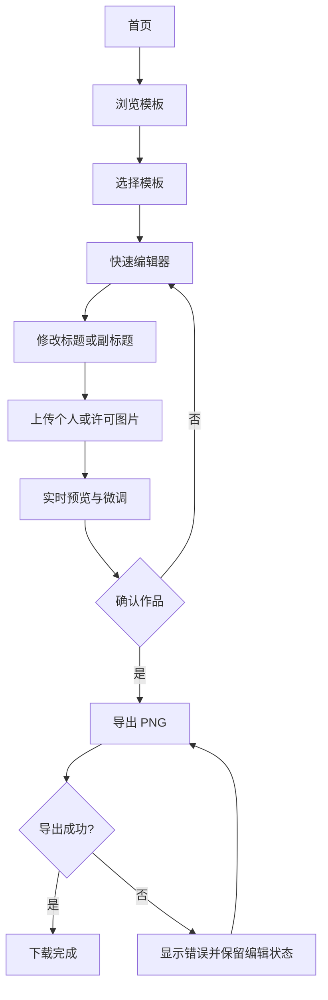
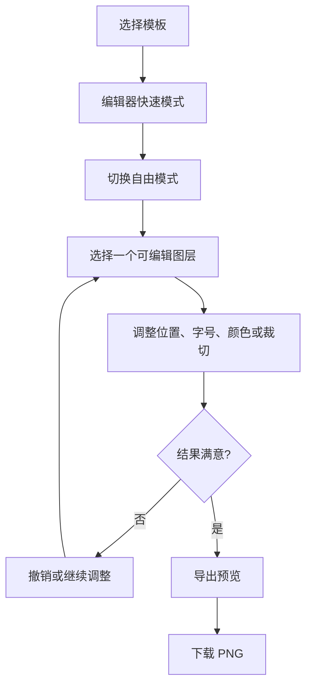

# 03｜信息架构与核心流程

## 1. 页面信息架构

```text
RE:ALBUM
├── 首页 /
│   ├── 产品价值与主 CTA
│   ├── 精选原创模板
│   ├── 使用步骤
│   └── 素材 / 独立性说明
├── 模板库 /templates
│   ├── 分类与筛选
│   ├── 模板卡片
│   └── 模板详情预览（可选轻量弹层）
├── 编辑器 /create/:templateId
│   ├── 顶部：返回、模板名、撤销/重做、导出
│   ├── 画布预览
│   ├── 成品切换：封面 / 黑胶唱片 / 社交分享图
│   ├── 模式切换：快速 / 自由
│   ├── 属性面板：文字、图像、颜色、图层
│   ├── 黑胶设置：唱片颜色、封套层次、曲目显示
│   └── 分享图设置：画布尺寸、布局、个人短评、标签与评分
│   └── 重置与帮助
├── 关于与使用说明 /about
└── 素材与隐私说明 /rights-and-privacy
```

## 2. 导航原则

- 首页的主行动直接进入模板库或精选模板编辑，不要求注册。
- 编辑器始终显示“返回模板库”和导出入口。
- 错误提示靠近发生问题的控件；导出状态显示在导出入口附近。
- 权利和隐私说明在上传、导出和页脚处均有可达入口。

## 3. 核心流程 A：快速创作并导出



## 4. 核心流程 B：自由编辑



## 5. 页面状态

| 页面 | 必须覆盖的状态 |
|---|---|
| 模板库 | 首次加载、空列表、分类无结果、缩略图缺失 |
| 编辑器 | 初始化、正常编辑、上传中、上传失败、撤销边界、重置确认 |
| 导出 | 准备中、导出中、成功、失败可重试 |
| 移动端 | 面板收起/展开、画布缩放、触控可达 |

